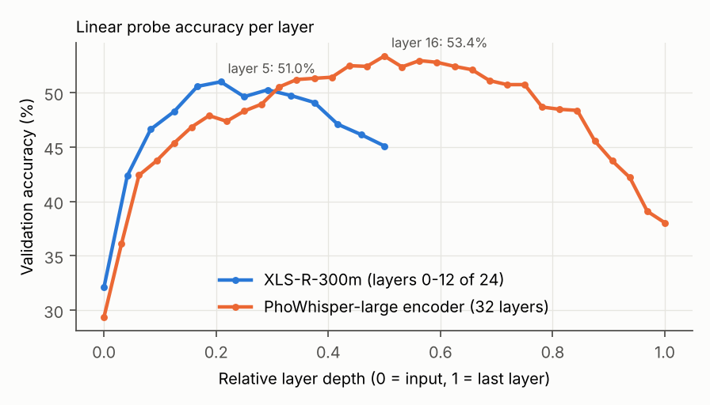
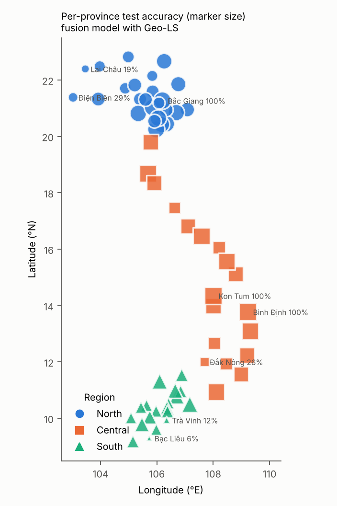

# Geography-Aware Province-Level Vietnamese Dialect Identification

Identifying which of Vietnam's **63 provinces** a speaker comes from, using **frozen self-supervised speech encoders** (XLS-R + PhoWhisper) and **Geo-aware Label Smoothing (Geo-LS)**, on the [ViMD](https://huggingface.co/datasets/nguyendv02/ViMD_Dataset) corpus.

Course project — *Deep Learning in Data Science*, University of Information Technology, VNU-HCM.
Author: **Tho Dang** (24521715).

📄 Paper (IEEE format): [`paper/paper.pdf`](paper/paper.pdf)

---

## Highlights

| | ViMD paper (best, fine-tuned) | **Ours** |
|---|---|---|
| Macro-F1, 63 provinces (official test set) | 0.411 (PhoWhisper-base) | **0.637** (ensemble) / **0.631** (single fusion model) |
| Accuracy | – (not reported) | **64.6%** (ensemble) / **63.9%** (single model) |
| Region accuracy (North/Central/South) | – | **94.4%** |
| Mean distance of an error to the true province | – | **80 km** |

- **Frozen encoders beat fine-tuning.** A learned layer-weighted sum (SUPERB-style) over frozen XLS-R-300m and PhoWhisper-large features plus a small MLP outperforms full fine-tuning, LP-FT and CNN/Transformer frame-level heads in this low-resource setting (~240 training utterances per province).
- **Geo-LS** keeps label smoothing's `1 − ε` mass on the true province but spreads `ε` to other provinces proportionally to `exp(−distance/τ)`. It reduces geographic error by 8–19 km in every setting tested, at no significant accuracy cost on the final model.
- **Confound controls.** Text-only (TF-IDF, PhoBERT), spectrum-only (LTAS) baselines and place-name-free test subsets show that most of the accuracy comes from accent, not spoken place names or recording channel.

## Method

```
waveform ─► frozen XLS-R-300m (layers 0–12) ─► mean-pool per layer ─► standardise ─► softmax layer weights ─┐
        └─► frozen PhoWhisper-large encoder (33 states) ─► same ──────────────────────────────────────────┴─► concat (2304-d) ─► MLP (512, GELU, dropout 0.3) ─► 63 provinces
                                                                                       trained with Geo-LS (ε = 0.3, τ = 200 km)
```

Geo-LS target for true province *i*:

$$
q_i(j) = \begin{cases} 1-\varepsilon & j=i \\ \varepsilon \dfrac{\exp(-d(i,j)/\tau)}{\sum_{k\neq i}\exp(-d(i,k)/\tau)} & j\neq i \end{cases}
$$

where *d* is the haversine distance between provincial capitals.

## Main results (ViMD test set, 3-seed ensembles, 95% bootstrap CI)

| Model | Accuracy (%) | Macro-F1 | Top-5 (%) | Region (%) | Mean error (km) | ≤100 km (%) |
|---|---|---|---|---|---|---|
| Baseline: XLS-R, all layers, CE (single run) | 49.2 [47.2, 51.3] | 0.486 | – | 89.4 | – | – |
| B: XLS-R, full utterance, LS | 57.5 [55.2, 59.6] | 0.569 | 81.1 | 88.9 | 127 | 69.2 |
| C: PhoWhisper-large, LS | 58.4 [56.2, 60.5] | 0.575 | 84.3 | 93.0 | 98 | 71.9 |
| D: Fusion B + C, LS | 64.2 [62.0, 66.2] | 0.635 | 85.6 | 93.3 | 88 | 75.8 |
| **D: Fusion B + C, Geo-LS (proposed)** | 63.9 [61.6, 65.9] | 0.631 | 86.3 | **94.4** | **80** | 76.4 |
| Ensemble B + C + D, LS | **64.6** [62.4, 66.6] | **0.637** | **86.5** | 93.8 | 82 | **76.6** |

Full numbers: [`results/final/final_report.json`](results/final/final_report.json). All intermediate experiment reports are in [`results/`](results/).

<p align="center">
  
  
</p>

## Repository structure

```
notebooks/
  00_vimd_feasibility.ipynb     quick feasibility check on a subset
  01_preprocess_vimd.ipynb      download ViMD, resample to 16 kHz, write parquet shards + metadata
  02_baselines_vimd.ipynb       LTAS / MFCC / TF-IDF / PhoBERT controls, frozen XLS-R baseline
  03_geo_analysis_vimd.ipynb    confound analysis (place names, channel), geography of errors
  04_geo_ls_vimd.ipynb          CE vs LS vs SORD vs Geo-LS grid (selects ε, τ on validation)
  05_finetune_xlsr_vimd.ipynb   full fine-tuning of XLS-R (negative result)
  06_lpft_xlsr_vimd.ipynb       LP-FT (negative result)
  07_final_probe_vimd.ipynb     XLS-R with 13 states (embedding + layers 1–12)
  08_frame_models_vimd.ipynb    frame-level heads: stats pooling, ASP, ECAPA-style, Transformer
  08b_frame_models_vimd.ipynb   same with 1024-d frames and full 12 s
  09_improve_vimd.ipynb         full-utterance XLS-R + PhoWhisper-large features, fusion
  10_final_verify_vimd.ipynb    final models, confound checks, paired bootstrap, figures
results/                        JSON reports produced by the notebooks
paper/                          IEEE-format paper (LaTeX source, figures, PDF)
```

Notebook explanations and comments are written in Vietnamese.

## Reproducing

All experiments ran on **Google Colab Pro** (mostly an NVIDIA L4, 24 GB). Data, features and results are stored on Google Drive under `MyDrive/vimd_dl/` (change `DRIVE_ROOT` at the top of each notebook if needed).

1. Accept the dataset terms on Hugging Face and add a `HF_TOKEN` secret in Colab.
2. Run the notebooks in order. The minimum path to the final model is:
   `01` → `02` → `04` → `09` → `10`.
   The other notebooks reproduce the ablations and negative results reported in the paper.
3. Feature extraction takes about 15–75 minutes per backbone; every classification head trains in under a minute from cached features.

Python dependencies are listed in [`requirements.txt`](requirements.txt) (Colab already provides most of them).

## Limitations

- Province labels are partly confounded with the recording channel (ViMD audio comes from local broadcasters). Results describe ViMD-like recordings, not arbitrary microphones.
- No out-of-domain evaluation yet.
- Labels follow the 63-province boundaries in force before the 2025 merger; each province is represented by its capital's coordinates.
- The comparison with the ViMD paper is not a controlled ablation: the paper fine-tunes on ≤10 s segments, while we freeze the encoders and pool over the whole utterance.

## Data and license

- **Dataset:** ViMD — N. Van Dinh, T. C. Dang, L. T. Nguyen, K. Van Nguyen, *"Multi-dialect Vietnamese: Task, dataset, baseline models and challenges,"* EMNLP 2024 ([arXiv:2410.03458](https://arxiv.org/abs/2410.03458)). Licensed **CC BY-NC-ND 4.0**. This repository does **not** redistribute any audio or transcripts; the notebooks download the data from Hugging Face.
- **Code:** MIT License (see [`LICENSE`](LICENSE)).

## Citation

```bibtex
@misc{dang2026geodialect,
  title  = {Geography-Aware Province-Level Vietnamese Dialect Identification with Frozen Self-Supervised Speech Representations},
  author = {Dang, Tho},
  year   = {2026},
  note   = {Course project, Deep Learning in Data Science, University of Information Technology, VNU-HCM}
}
```
