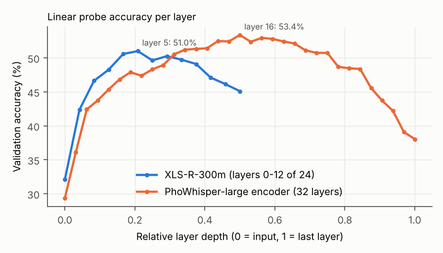
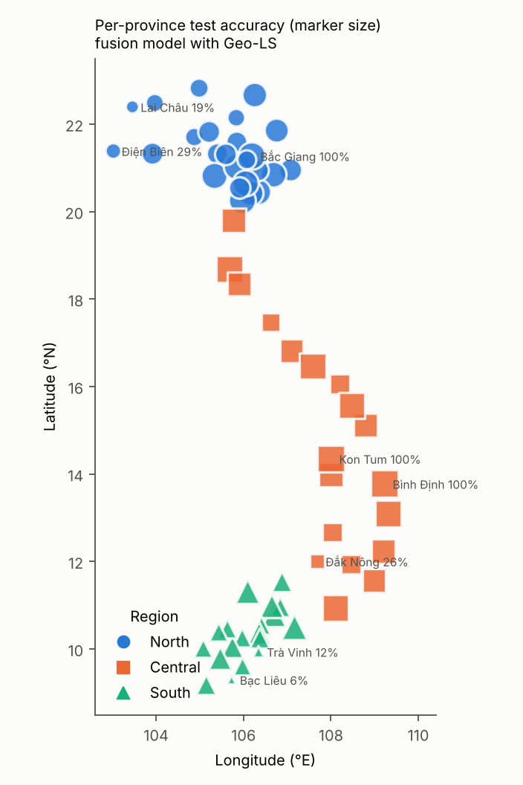

# Geography-Aware Province-Level Vietnamese Dialect Identification

Classifying Vietnamese speech into the **63 provinces** of the [ViMD](https://huggingface.co/datasets/nguyendv02/ViMD_Dataset) corpus with **frozen pretrained speech encoders** (self-supervised XLS-R + ASR-trained PhoWhisper), a learned layer-weighted head, and **Geo-aware Label Smoothing (Geo-LS)**.

Course project for *Deep Learning in Data Science*, University of Information Technology, VNU-HCM.
Author: **Tho Dang** (24521715).

📄 **Paper (IEEE format):** [`paper/paper.pdf`](paper/paper.pdf), with LaTeX source in [`paper/main.tex`](paper/main.tex).

> **What the label means.** ViMD labels each recording with the province of the **broadcasting station** that aired it (interviews with local residents). The task is therefore broadcasting-province classification, used as a proxy for provincial dialect, not verified speaker-origin identification.

---

## Key results

ViMD official test set (2,026 utterances, 1,344 speakers). Brackets are 95% speaker-level cluster-bootstrap CIs.

| Model | Accuracy (%) | Macro-F1 | Top-5 (%) | Region (%) | Mean error (km) | ≤100 km (%) |
|---|---|---|---|---|---|---|
| Baseline: XLS-R, 25 states, CE (single run) | 49.2 [46.3, 51.9] | 0.486 | 77.9 | 89.4 | 140 | 64.3 |
| B: XLS-R (13 states, full utterance), LS | 57.5 [54.6, 60.3] | 0.569 | 81.1 | 88.9 | 127 | 69.2 |
| C: PhoWhisper-large encoder, LS | 58.4 [55.7, 61.2] | 0.575 | 84.3 | 93.0 | 98 | 71.9 |
| D: Fusion B + C, LS | 64.2 [61.2, 66.9] | 0.635 | 85.6 | 93.3 | 88 | 75.8 |
| **D: Fusion B + C, Geo-LS** | 63.9 [61.0, 66.6] | 0.631 | 86.3 | **94.4** | **80** | 76.4 |
| Ensemble of B, C and D (9 heads), LS | **64.6** [61.8, 67.4] | **0.637** | **86.5** | 93.8 | 82 | **76.6** |

Rows B–D are three-seed ensembles; a single fusion head reaches 61.0 ± 0.6% (Geo-LS) and 61.1 ± 1.2% (LS).
The best fine-tuned baseline published with ViMD reports 0.411 macro-F1 under a different protocol (fine-tuned PhoWhisper-base on ≤10 s segments), so this is **not a controlled comparison**.

**Main findings**

- **Fusion matters most.** Fusing XLS-R and PhoWhisper adds 6.7 points over XLS-R alone and 5.7 over PhoWhisper alone.
- **Geo-LS** gives the true province a fixed mass `1 − ε` and spreads `ε` over the other provinces in proportion to `exp(−distance/τ)`. Compared with standard label smoothing, it reduced the mean geographic error by 8–26 km in all four settings tested (fusion: −8.2 km, CI −15.3 to −1.2). It costs about one point of single-run accuracy for XLS-R alone and has no significant cost for the fusion model (−0.3 points, CI −1.5 to 0.9). The loss form is **not new**: it is similarity-based label smoothing with a geographic kernel, related to SORD and to PIGEON's haversine smoothing.
- **Confound controls.** Accuracy is largely retained:
  - on utterances that name no listed province or city;
  - on utterances misclassified by text baselines (TF-IDF, PhoBERT);
  - across speaker sex.

  The place-name list covers province names, most capitals and a few cities, not district names.
- **Robustness: the model depends on recording conditions.**
  - Equalising each utterance's long-term spectrum lowers accuracy from 64% to 47%.
  - Applying the true province's average spectrum instead keeps 56.5%. The 9.4-point difference (paired CI 7.7–11.0) measures reliance on province-conditioned spectral information. That information mixes channel, voice and dialect.
  - 20 dB white noise lowers accuracy to ~30%, and telephone-band audio to ~16%.
- **Negative results.** In the configurations tried, full fine-tuning (under-trained after 6 epochs), LP-FT and CNN or Transformer frame-level heads did not beat frozen features with mean pooling. The training set has about 240 utterances per province.
- **Calibration.** Raw ensembles are under-confident (ECE ≈ 0.33). Temperature scaling on validation reduces ECE to 0.03–0.05.

<p align="center">
  
  
</p>

## Method

```
waveform ─► frozen XLS-R-300m (embedding + layers 1–12) ─► mean-pool per layer ─► standardise ─► softmax layer weights ─┐
        └─► frozen PhoWhisper-large encoder (33 states) ─► same ─────────────────────────────────────────────────────┴─► concat (2,304-d) ─► MLP (512, GELU, dropout 0.3) ─► 63 provinces
                                                                                           trained with Geo-LS (ε = 0.3, τ = 200 km)
```

$$
q_i(j) = \begin{cases} 1-\varepsilon & j=i \\ \varepsilon \dfrac{\exp(-d(i,j)/\tau)}{\sum_{k\neq i}\exp(-d(i,k)/\tau)} & j\neq i \end{cases}
$$

where *d* is the haversine distance between provincial capitals.

## Repository structure

```
notebooks/
  pipeline/                       experiments, in the order they were run
    00_vimd_feasibility           feasibility check on a balanced subset (25-layer XLS-R probe)
    01_preprocess_vimd            download ViMD, resample to 16 kHz, parquet shards + metadata, speaker-overlap check
    02_baselines_vimd             LTAS / MFCC / TF-IDF / PhoBERT controls, frozen XLS-R baseline (Table II)
    03_geo_analysis_vimd          place-name and channel confounds, CE vs LS / SORD / region / coordinate objectives
    04_geo_ls_vimd                Geo-LS grid on 25 XLS-R states (ε, τ selected on validation)
    05_finetune_xlsr_vimd         full fine-tuning of XLS-R (negative result)
    06_lpft_xlsr_vimd             LP-FT (negative result)
    07_final_probe_vimd           objective comparison on 13 XLS-R states
    08_frame_models_vimd          frame-level heads, 512-d PCA, 6 s crops (earlier run)
    08b_frame_models_vimd         frame-level heads, 1,024-d, 12 s (Table VI)
    09_improve_vimd               full-utterance XLS-R + PhoWhisper-large features, fusion, layer probes
    10_final_verify_vimd          final models, confound subsets, paired bootstrap, figures (Table VII)
  audit/                          statistics and robustness added after peer review
    11_stat_audit_vimd            speaker-level bootstrap, seed variability, ECE/Brier, non-inferiority, Mantel test, speaker sex
    12_robustness_vimd            five-seed objective comparison, temperature scaling, channel perturbations
    14_recompute_vimd             recomputes the paper's numbers from raw predictions
results/
  experiments/                    one JSON report per pipeline notebook
  final/final_report.json         final models (notebook 10)
  audit/                          audit_report.json (11), recompute_report.json (14)
  robustness/                     robustness_report.json (12)
  provinces.csv                   per-province counts and regions
paper/                            main.tex, figures, paper.pdf
```

Notebook text and comments are in Vietnamese.

## Reproducing

All experiments ran on **Google Colab Pro** (mostly an NVIDIA L4, 24 GB). Data, features and results are stored on Google Drive under `MyDrive/vimd_dl/`; change `DRIVE_ROOT` at the top of a notebook to use another location.

1. Accept the dataset terms on Hugging Face and add an `HF_TOKEN` secret in Colab.
2. Minimum path to the final model: `01 → 02 → 07 → 09 → 10` (notebooks 09 and 10 read the Geo-LS parameters chosen in 07; 04 is the fallback). The other pipeline notebooks reproduce the ablations and negative results.
3. Audit notebooks: `11`, `12` (needs a GPU for feature re-extraction) and `14` (CPU only) run after `10`.
4. Feature extraction takes 15–75 minutes per backbone. Each head trains in under a minute from cached features.

Dependencies: [`requirements.txt`](requirements.txt). Colab provides most of them.

**What can be recomputed.** Notebook 14 recomputes Tables I, II, III and VII from the saved predictions, along with paired differences, the Mantel test, the speaker-sex analysis and the channel contrasts. All match the paper. The per-seed results of Tables IV–VI, the fine-tuning logs and the layer probes come from the JSON reports, because those runs did not save test probabilities.

## Limitations

- **Labels.** Labels denote the broadcasting province. Accent and broadcaster-specific recording conditions cannot be fully separated on ViMD.
- **Robustness.** The system is sensitive to spectral equalisation, noise and telephone-band audio. It has not been tested on independently recorded speech from speakers of known origin.
- **Test-set reuse.** The test set was evaluated after each experimental stage, and the main system was chosen after test results were known, so test accuracies may be optimistic.
- **Possible pretraining overlap.** Overlap between the encoders' pretraining data and ViMD cannot be checked.
- **Boundaries and geography.** Labels follow the 63-province boundaries in force before the 2025 merger, and distances use the hand-entered coordinates of the provincial capitals.

## Data and license

- **Dataset:** ViMD. N. Van Dinh, T. C. Dang, L. T. Nguyen and K. Van Nguyen, *"Multi-dialect Vietnamese: Task, dataset, baseline models and challenges,"* EMNLP 2024 ([arXiv:2410.03458](https://arxiv.org/abs/2410.03458)). Licensed **CC BY-NC-ND 4.0**. This repository contains **no** audio or transcripts; the notebooks download the data from Hugging Face.
- **Code:** MIT License (see [`LICENSE`](LICENSE)).

## Citation

```bibtex
@misc{dang2026geodialect,
  title  = {Geography-Aware Province-Level Vietnamese Dialect Identification with Frozen Pretrained Speech Encoders},
  author = {Dang, Tho},
  year   = {2026},
  note   = {Course project, Deep Learning in Data Science, University of Information Technology, VNU-HCM},
  url    = {https://github.com/stevedang2805/vimd-geo-dialect-id}
}
```
